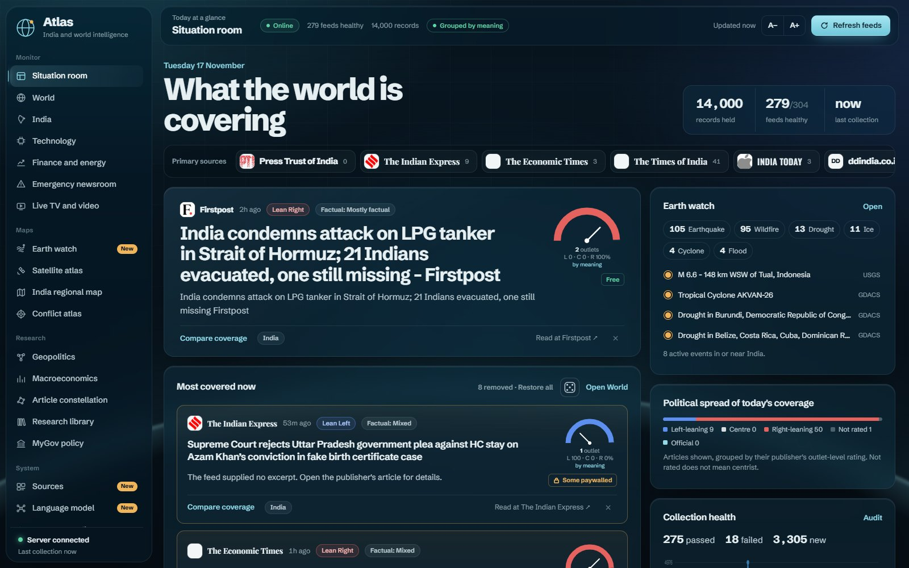
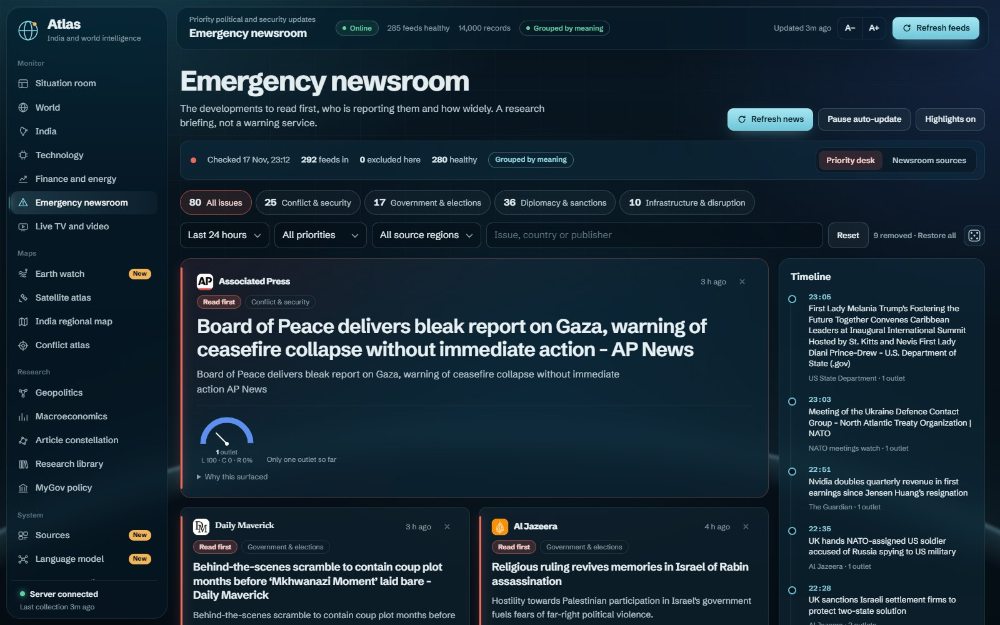
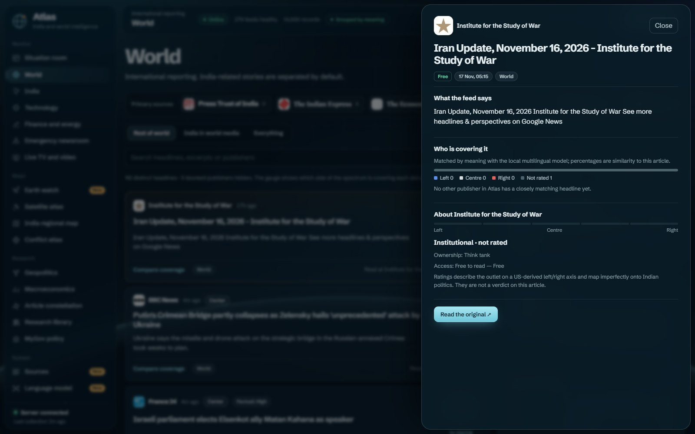
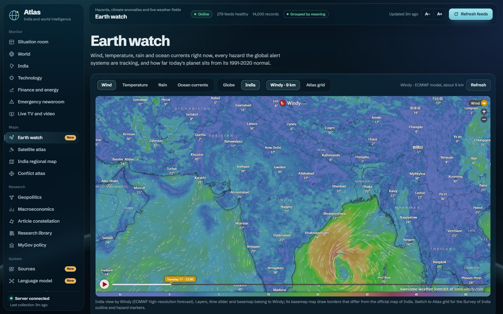
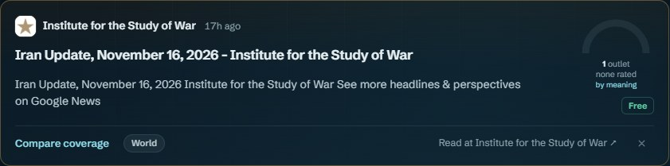

# Atlas

**A local-first news and geopolitics dashboard for India and the world.**

Atlas collects reporting from around 290 feeds, including wires, broadcasters, Indian national and regional papers, ministries, think tanks and scholarly indexes. It shows who is covering a story, which side of the spectrum they lean, whether you can read them without a subscription, and what is happening on the planet: hazards, weather and climate anomalies.

It runs entirely on your own computer. There is no account, no cloud service and no tracking. The core app needs nothing but Python. An optional small language model, which also runs locally, groups stories by meaning across English and Indian languages.

> Atlas is a research and reading tool, not a news-verification or warning service. Bias and paywall labels describe publishers, not individual articles. Read the originals before drawing conclusions.

## Preview

| | |
|---|---|
|  |  |
| **Situation room:** the day at a glance | **Emergency newsroom:** priority updates grouped into stories |
|  |  |
| **Compare coverage:** one story across outlets | **Earth watch:** live weather for India and global hazards |



**[See every page →](docs/SCREENSHOTS.md)**

---

## Contents

1. [What Atlas does](#1-what-atlas-does)
2. [Quick start for experienced Python users](#2-quick-start-for-experienced-python-users)
3. [Step-by-step install for people new to Python](#3-step-by-step-install-for-people-new-to-python)
4. [Optional: grouping by meaning and generated labels](#4-optional-grouping-by-meaning-and-generated-labels)
5. [Using Atlas day to day](#5-using-atlas-day-to-day)
6. [How Atlas is built](#6-how-atlas-is-built)
7. [The models, and why these ones](#7-the-models-and-why-these-ones)
8. [How the judgements are made](#8-how-the-judgements-are-made)
9. [Configuration reference](#9-configuration-reference)
10. [Running the tests](#10-running-the-tests)
11. [Project layout](#11-project-layout)
12. [Troubleshooting](#12-troubleshooting)
13. [Privacy and security](#13-privacy-and-security)
14. [Known limitations](#14-known-limitations)
15. [Data sources and credits](#15-data-sources-and-credits)
16. [Licence](#16-licence)

---

## 1. What Atlas does

| Page | What you get |
|---|---|
| **Situation room** | The day at a glance: the most widely covered story, a list of others, the political spread of today's coverage, Earth hazards and collection health. |
| **World, India, Technology, Finance and energy** | News desks with filters for region, state and city, publisher lean and paywalls. Every card carries a half-donut *coverage gauge*. |
| **Emergency newsroom** | Political and security developments ranked by a transparent rule set, grouped into stories, with a timeline and per-source controls. |
| **Live TV and video** | Only streams YouTube confirms are live, and only uploads it confirms are public and embeddable. The **Geopolitics reel** plays the last 24 hours of news videos from international broadcasters, one after another. |
| **Earth watch** | Earthquakes, cyclones, floods, wildfires and volcanoes from GDACS, NASA EONET and USGS. Also global temperature and sea-surface anomalies (Copernicus ERA5), and Windy's live wind, rain and temperature map for India. |
| **Satellite atlas** | Esri, OpenStreetMap and NASA imagery with hazard layers and the official Survey of India boundary. |
| **India regional map** | Where Indian coverage is concentrated, drawn on the Survey of India state map. |
| **Conflict atlas, Geopolitics, Macroeconomics** | Published conflict maps, summit and bloc calendars, and economic indicators with their source links. |
| **Article constellation** | A 3-D map of retrieved reporting, clustered by shared vocabulary. |
| **Research library, MyGov policy** | Think-tank analysis, scholarly metadata from OpenAlex, and ministry and scheme updates. |
| **Sources** | Every publisher with its logo, masthead, bias rating and paywall model. Mark publishers as *primary* or *block* them everywhere. |
| **Research radar** | New machine learning papers from arXiv ranked against your own papers, the Vanschoren and AMOR/e lab, weekly themes, a related-work check, OpenML and Hugging Face, conference deadlines and a reading queue with BibTeX export. |
| **Language model** | Status and tuning for grouping by meaning and the optional generated labels. |

Across the app:

- **Every headline panel has a dice button.** It deals a different set of stories from everything Atlas holds.
- **Every article can be removed from the wall.** You can undo a removal, and a removed article still counts in coverage statistics.
- **Primary sources** you choose appear in a compact bar at the top of each desk. Click chips to show several outlets at once, use *Only* for one, or open the searchable list.
- **Coverage graph** on the Situation room and every desk: the outlets on the page as a network, linked by the stories they share and by how similar their coverage is. **Diffuse** on any article spreads outward from it: its story and sources, related stories on any desk, and outlets that haven't covered it yet. **Search further** fetches more.
- **Blocked publishers** disappear from every page, including the emergency newsroom and the language model's input.

---

## 2. Quick start for experienced Python users

**Requirements:** Python 3.10 or newer (developed and tested on 3.12 and 3.13), internet access for the feeds, and a modern browser. The core app has **no third-party Python dependencies**.

```bash
git clone https://github.com/a-moharil/Atlas.git
cd Atlas
python3 server.py                         # http://127.0.0.1:8765/
# or: python3 server.py --host 127.0.0.1 --port 8800
```

The first collection starts immediately and takes a few minutes, because around 290 feeds are polled politely. Pages fill in as results arrive. Collection repeats every 15 minutes while the server runs.

Optional grouping by meaning (about 220 MB, processor only):

```bash
python3 -m venv .venv && source .venv/bin/activate   # Windows: .venv\Scripts\activate
pip install -r requirements-lm.txt                   # fastembed -> ONNX Runtime, no PyTorch
bash install_language_model.sh                       # pre-downloads the model into ./model_cache
```

Optional generated labels: install [Ollama](https://ollama.com/download), run `ollama pull qwen2.5:1.5b`, then switch labels on in **System → Language model**.

Docker (core app only, data in a named volume):

```bash
docker compose up --build -d   # binds 127.0.0.1:8765 only
```

Useful environment variables: `OBS_DB` (database path), `OBS_REFRESH_SECONDS` (minimum 300) and `OBS_SKIP_NETWORK=1` (no outbound collection, for development). The full list is in [section 9](#9-configuration-reference).

---

## 3. Step-by-step install for people new to Python

You don't need to know how to program. You'll install one free program (Python), download Atlas, and double-click a file.

### 3.1 What is Python, and why do I need it?

Python is a programming language. Atlas is written in it, so your computer needs the Python *interpreter*, the program that reads Atlas's code and runs it. Installing Python is like installing a PDF reader so your computer can open PDFs. Atlas then runs as a small web server **on your own computer**, and you use it in your normal browser at a local address that only your computer can see.

### 3.2 Install Python

**Windows**

1. Go to <https://www.python.org/downloads/> and click the yellow **Download Python 3.x** button.
2. Open the downloaded installer.
3. **Important:** on the first screen, tick **"Add python.exe to PATH"** at the bottom. This lets Atlas find Python.
4. Click **Install Now** and wait for it to finish.
5. Check it worked:
   1. Press the Windows key, type `PowerShell`, and press Enter.
   2. Type `python --version` and press Enter.
   3. You should see something like `Python 3.13.1`.

   If the Microsoft Store opens instead, Windows is using a placeholder. Open **Settings → Apps → Advanced app settings → App execution aliases**, switch off the two *python* entries, and try again.

**macOS**

1. Go to <https://www.python.org/downloads/> and download the macOS installer.
2. Open it and follow the steps.
3. Open **Terminal** (press Cmd+Space, type `Terminal`).
4. Type `python3 --version`. On macOS the command is `python3`, not `python`.

**Linux (Ubuntu or Debian)**

Python is usually already installed. Check with `python3 --version`. If it's missing, run:

```bash
sudo apt update && sudo apt install python3 python3-venv python3-pip
```

### 3.3 Download Atlas

There are two ways:

- **Easiest:** on the Atlas GitHub page, click the green **Code** button, then **Download ZIP**. Right-click the downloaded file and choose **Extract All**, and put the folder somewhere permanent, such as `Documents\Atlas`.
- **With Git:** run `git clone https://github.com/a-moharil/Atlas.git`. Git makes later updates easier; see [section 5.6](#56-updating).

### 3.4 Start Atlas

- **Windows:** open the Atlas folder and double-click **`start_windows.bat`**. A black window opens and shows the browser address. **Leave that window open**, because it *is* Atlas. Closing it stops Atlas.
- **macOS or Linux:** in Terminal, go into the folder and start it:

  ```bash
  cd ~/Documents/Atlas
  ./start_linux_macos.sh
  ```

  If you see "permission denied", run `chmod +x start_linux_macos.sh` once, or use `python3 server.py` instead.

Now open your browser at **<http://127.0.0.1:8765/>**. `127.0.0.1` means "this computer", so nobody else can open it.

### 3.5 What to expect the first time

- The first collection takes **a few minutes**. Desks fill in as feeds respond, and the left sidebar shows *Server connected* and the collection progress.
- Atlas creates a file called `observatory.sqlite3` in its folder. This is **your database**: every article collected, your source choices and your settings. Keep it. Copy it into a new version of Atlas to carry your history over.
- To **stop** Atlas, close the black window (Windows) or press **Ctrl+C** in the Terminal.
- To **start** it again, repeat 3.4. Everything you collected is still there.

---

## 4. Optional: grouping by meaning and generated labels

Without these, Atlas groups stories by **shared headline keywords**, and that works. With them, it groups by **meaning**: "RBI holds repo rate" and "Reserve Bank keeps policy rate unchanged" become one story even though they share almost no words. This also works across English, Hindi, Bengali, Tamil, Telugu, Marathi, Gujarati, Urdu and 40+ other languages.

### 4.1 Grouping by meaning (recommended)

- **Windows:** double-click **`install_language_model.bat`**.
- **macOS or Linux:** run `bash install_language_model.sh`.

The installer:

1. installs one Python package, `fastembed`, with `pip` (Python's package installer, which came with Python);
2. downloads a ~220 MB multilingual model into the `model_cache` folder;
3. prints `Model ready: 384 dimensions`.

After that it works **offline**. Restart Atlas. The top bar switches from **Keyword mode** to **Grouped by meaning** once most recent articles have been processed. That takes a minute or two the first time, and then happens quietly after each collection.

> *Experienced users:* install into a virtual environment if you prefer: `python -m venv .venv`, activate it, then `pip install -r requirements-lm.txt`. Start Atlas with the same interpreter.

### 4.2 Generated labels and summaries (optional, off by default)

A second, slightly larger model can write a short neutral label, a one-to-two-sentence summary and a note on how outlets differ, for the top stories in the emergency newsroom.

1. Install **Ollama** from <https://ollama.com/download> and leave it running. It is a small background app that runs language models locally.
2. In PowerShell or Terminal, run `ollama pull qwen2.5:1.5b`. The download is about 1 GB.
3. In Atlas, open **System → Language model**, tick **Write labels and summaries**, click **Check Ollama**, then click **Write labels now**.

Everything written this way is tagged **Generated** and names the model that wrote it.

### 4.3 Tuning the grouping to your news

On **System → Language model**, **Check the grouping on your news** lists headline pairs whose similarity is close to the strictness setting, each marked *joined* or *kept apart*.

- If different events are being joined, raise the strictness.
- If the same event is being split, lower it.

The default (0.72) is a starting point. Check it against a day or two of your own feeds.

---

## 5. Using Atlas day to day

### 5.1 Reading a story card

- **Masthead:** the publisher's logo and name in a typeface close to their own.
- **Tags:** age, bias rating, and factual rating where a rater covers the outlet.
- **Coverage gauge:** a half donut showing the share of **left, centre and right-leaning outlets** covering the same story in Atlas. The needle is this publisher's own rating. "by meaning" or "by keywords" says how the story was grouped.
- **Access tag:** *Free*, *Free with registration*, *Metered*, *Mostly free* or *Subscription*. Articles the publisher marks as premium are flagged individually.
- **Compare coverage:** opens a drawer with the same story from other outlets. With the language model installed, each match shows a "% match".

### 5.2 Shaping the walls

- **Dice:** deals a different set of headlines in that panel, drawn from everything Atlas holds that matches your filters. The order holds through background refreshes. *Usual order* restores the normal ranking.
- **Remove (×):** removes an article from the walls. Syndicated copies of the same headline go with it, and in the newsroom the whole story card goes. *Undo* appears for 7 seconds, and *N removed · Restore all* brings everything back.
- **Sources page:**
  - Mark outlets as **Primary**: logo chips at the top of each desk, plus a *Primary first* toggle.
  - **Block** an outlet: hidden everywhere, and its feeds are not even fetched.
- **Coverage audit:** feed health, failures and collection history.

### 5.3 Coverage graph and diffusion

The **Coverage graph** panel on the Situation room, World, India, Technology and Finance maps the outlets behind the articles on that page.

- **Nodes:** one per outlet, sized by its articles on the page and coloured by its lean. An amber ring marks a primary source.
- **Solid lines:** shared stories. Two outlets that covered the same events are linked, and the line thickens with the share of their stories they have in common.
- **Dashed lines:** similar topics. Each article from one outlet is matched to the closest article from the other, using the local language model (or keywords without it). This works even for outlets that cover many different subjects.
- **Clicking an outlet:** shows its stories. Open a story to see every article in it (the article level), or use *Show only this source* or *Add to selection* to filter the page. **Expand** opens the graph full screen.

**Diffuse** (on every story card, and on every article inside the graph) starts from one article:

1. **This story:** its meaning group and every outlet that covered it.
2. **Related stories:** close in meaning, on any desk, found by a random walk with restart over articles, stories and outlets, using each article's nearest neighbours by meaning.
3. **Also from these outlets:** stories reached only through the same sources, kept separate because they aren't similar in meaning.
4. **Not covering this yet:** outlets whose recent articles are close to this story but which haven't covered it.

**Reading the diffusion view:**

- **Header:** the story you started from, with its lean gauge, desks, outlet and article counts, and how many usual outlets haven't covered it.
- **Map and coverage tab:** the starting story sits at the centre. Distance from the centre shows how different a story is in meaning (rings at 80%, 60% and 40% similar); the quarter shows its desk (World, Technology, Finance, India); dot size shows how many outlets carry it. Grey dots marked a–d share outlets but not meaning.
- **Who covered what:** outlets grouped by lean (Left to Right, then not rated) against the starting story and the numbered related stories. A filled dot means the outlet covered it; a dashed ring means it usually covers this kind of story but hasn't covered this one. Unknown aggregators are folded into *Other outlets*. Click an outlet to select it, or a column number to open that story.
- **Timeline tab:** one line per story, placed by similarity, with each article as a dot at its publication time, coloured by its outlet's lean.
- **Lists:** stories are numbered as on the map and in the table, most similar first, with eight shown and *Show more* for the rest. Each story shows a small lean gauge; each article shows the outlet's logo, lean label and paywall label. Titles drop the trailing " - Publisher" and prefer a primary or rated outlet's headline; the same headline from the same outlet appears once.

**Search further** sends one open Google News search for the story's key terms, plus one per gap outlet (up to three). New articles join the desk you started from and are processed by the language model in the background, after which the diffusion updates.

### 5.3a Geopolitics reel and the floating player

The **Geopolitics reel** on *Live TV and video* plays recent news videos from international broadcasters one after another: Al Jazeera English, France 24, Sky News, AP, TRT World, CNA, Euronews, NHK World, ABC News (Australia), plus BBC News, DW, Reuters and WION.

- **What it plays:** uploads from the last 24 hours, news only. Shorts, sport, entertainment and lifestyle are left out. *Geopolitics* (the default) keeps videos whose titles name conflicts, diplomacy, sanctions, summits, elections or the countries and leaders involved; *All news* keeps every news video. Channels take turns, so one broadcaster can't fill the reel.
- **Playing:** videos start muted, because browsers block autoplay with sound. Unmute in the player and later videos stay unmuted. *Next video after* sets how long each video plays (1, 3 or 5 minutes, or until it ends).
- **Stop circulating** holds the current video; *Resume circulating* carries on. *Previous*, *Next* and the *Up next* list move by hand; *Remove* takes a video out of the reel.
- **Videos that won't play:** if YouTube refuses a video in your browser (removed, embedding switched off, or blocked in your region), the reel skips it and Atlas doesn't offer it again for a week.
- **Checking the channels:** `python tools/check_geo_channels.py` prints the name YouTube reports for each channel and how many uploads it had in the last 24 hours. The list lives under `geo_reel` in `source_registry.json`.

**The floating player** (any video or live stream you open) can be:

- **moved** by dragging its title bar (or with the arrow keys when the bar has focus); the position is remembered;
- **resized** from its bottom-right corner;
- **maximised** with the square button or a double-click on the title bar (Esc restores it);
- **put into full screen** with the corner button (Esc or the same button exits).

When YouTube shows *This video is unavailable*, Atlas now notices. For a live stream it asks for a fresh live check and tries the channel's current live stream; if that fails too, it says why and offers *Watch on YouTube*.

### 5.4 Research radar

The radar ranks new research against **your papers**, a list you control under **Research radar → Your papers**. It comes seeded with six papers. Add more by pasting an arXiv link or ID, a DOI, or an exact title; Atlas looks each one up on arXiv, Crossref or OpenAlex.

- **Where papers come from** (all open, no account needed):
  - **Watch phrases:** extracted automatically from your papers, such as *pipeline synthesis*, *training dynamics* or *issue trackers*. You can add or remove phrases under **Your papers**.
  - **arXiv search:** small queries for your watch phrases in cs.LG, stat.ML, cs.AI, cs.NE, cs.CL and cs.SE. They run hourly but only ask for papers newer than the last run.
  - **arXiv daily listings:** each category's daily RSS feed, the broad view behind Themes.
  - **Hugging Face:** the daily papers list (with upvotes) and paper search for your phrases.
  - **OpenAlex:** journals and proceedings for your phrases. It works without a key on a small daily allowance; a free key from openalex.org raises it tenfold and can be pasted under **Your papers → Sources**.
  - **Refreshing:** papers appear as each query returns, and the sources keep refreshing in the background while Atlas runs. arXiv publishes once a day (Sunday to Thursday evenings, US Eastern time), so new arXiv papers arrive once a day however often Atlas checks.
- **For you:** the papers sorted into five lanes: AutoML and pipeline synthesis, training dynamics and diagnostics, transformers and representations, software engineering for ML, and data-centric ML.
  - Each paper shows a "% match" to your closest paper and names it.
  - The dice and Remove work as on the news walls.
- **Search and filters:** a search box with an **Auto / Keyword / Semantic** switch.
  - **Keyword** matches exact words. It supports `"a phrase"`, `author:name`, `cat:cs.LG`, `title:word` and `-exclude`.
  - **Semantic** ranks papers by meaning with the local model, for when you describe an idea in a sentence.
  - **Auto** picks keyword search for quotes, fields, exclusions or a few words, and semantic search for a description. It says which it chose, and one click reruns the search in the other mode.
  - **Filters:** lane, category, source, minimum match, saved or not, and on Hugging Face daily papers.
- **Vanschoren and AMOR/e:** papers with Joaquin Vanschoren as an author, from arXiv and OpenAlex. Names of current AMOR/e members are highlighted.
- **Themes:** the period's papers grouped by meaning into topics, labelled with phrases the papers share.
- **Related-work check:** paste an abstract or a draft paragraph. Atlas returns the closest papers it holds, plus older work from an OpenAlex search re-ranked on your computer. Only the search phrases are sent to OpenAlex.
- **Benchmarks and datasets:** the newest OpenML datasets and tasks, and trending Hugging Face models. Radar papers that are on Hugging Face's daily papers list show their upvotes.
- **Deadlines:** upcoming paper deadlines, rebuttals and decisions for NeurIPS, ICML, ICLR, KDD, ICSE and MSR, converted to your time zone. The AutoML Conference isn't in the open dataset, so it links to its official site.
- **Reading queue:** save papers, mark them *to read*, *reading* or *read*, keep notes, and export all or selected papers as BibTeX.
- **Weekly digest (optional):** your local Ollama model summarises the week's top matches, marked *Generated*.

Lanes, arXiv categories, the traced lab, the conferences and query sizes are set in `radar_config.json`.

**Checking the sources.** **Your papers → Sources → Test sources** sends one small request to each source. Outside Atlas, `python tools/check_radar_sources.py` does the same and prints which sources answer from your network.

### 5.5 Keeping your data

Your data lives in **`observatory.sqlite3`**, plus `model_cache/` if you installed the model. Neither is uploaded to GitHub (they're in `.gitignore`). To move to a new computer or a new version, copy both into the new folder. Older databases can also be migrated explicitly:

```bash
python migrate_database.py "path/to/old/observatory.sqlite3"
```

### 5.6 Updating

- **If you used `git clone`:** stop Atlas, run `git pull`, and start it again.
- **If you downloaded a ZIP:** download the new ZIP, extract it to a new folder, then copy `observatory.sqlite3` (and `model_cache/`) from the old folder into it.

---

## 6. How Atlas is built

### 6.1 Design principles

1. **Local-first.** One process on your machine and one SQLite file. No account and no external database.
2. **Standard library only for the core.** The server, the feed parser, the scheduler and the database layer use only Python's standard library, so installation is "install Python, run a file". Optional features (the language model) are optional dependencies that degrade cleanly when they're missing.
3. **Say where everything comes from.** Every rating, map layer and hazard names its provider. Nothing is presented as more certain than its source.
4. **Fail visibly, never silently.** A missing model shows *Keyword mode*. A failed feed shows in the coverage audit. A page that cannot draw shows an explanation instead of going blank.
5. **No invented content.** Atlas never writes headlines. Generated labels are opt-in, marked, and built only from text Atlas already holds.

### 6.2 Architecture

```
            ┌──────────────────────────── your computer ────────────────────────────┐
 Feeds ───► │  server.py  (ThreadingHTTPServer, stdlib)                              │
 RSS/Atom   │   ├─ collection cycle every 15 min ─► parse ─► clean ─► SQLite         │
 Google     │   │     (bounded thread pool, per-source timeouts, blocked hosts skip) │
 News       │   ├─ retrieval_jobs: cached background jobs for slow providers         │
 YouTube    │   ├─ semantic.py  ─ fastembed/ONNX (optional) ─► vectors in SQLite     │
 OpenAlex   │   ├─ lm_labels.py ─ Ollama on 127.0.0.1 (optional) ─► labels in SQLite │
 GDACS…     │   └─ JSON API  /api/*                                                  │
            │                                                                        │
            │  static/  (vanilla JavaScript, no build step)                          │
            │   atlas3.js shell + one module per page, talking only to /api/*        │
            └──────────────────────────────── browser ───────────────────────────────┘
```

- **Server (`server.py`):** a `ThreadingHTTPServer` serving the static front end and about 40 JSON endpoints. It binds to `127.0.0.1` by default.
- **Collection:**
  - A background thread polls the registry (`source_registry.json`) every `OBS_REFRESH_SECONDS`.
  - Requests run in a bounded thread pool (8 workers) with per-request timeouts.
  - Regional Google News queries poll at most hourly, to avoid throttling.
  - Each item is normalised (title, publisher, link, published time, excerpt) and stored once per source, keyed by a hash of source and link. Syndicated copies of a headline across outlets are collapsed when displayed.
- **Storage:** SQLite in WAL mode (`observatory.sqlite3`). Tables include entries, feed status, collection runs, publisher preferences, removed-from-wall IDs, embeddings, generated labels and settings. Every module creates its own tables, so databases upgrade in place.
- **Visibility filter:** one SQL clause (`content_cleanup.where_visible`) combines your genre cleanup rules (for example "hide sports scores") with blocked publishers. Every query that feeds a page goes through it, which is why a block applies everywhere.
- **Slow providers** (hazards, climate series, research indexes, logos) use `retrieval_jobs`: a request returns the cached result at once and refreshes it in the background, with a time-to-live per provider.
- **Map tiles** go through `tile_gateway.py`, a small caching proxy. The browser never talks to tile servers directly, which avoids cross-origin failures and repeated downloads.
- **Front end:**
  - Vanilla JavaScript modules (`static/*.js`) with no framework and no build step. `atlas3.js` is the shell (navigation, desks, cards, gauge, drawer) and each specialised page is a self-contained module on `window` (`ATLASEmergency`, `ATLASEarth`, `ATLASLM`, `ATLASWall`…).
  - Rendering is plain HTML strings with escaping.
  - Every page render is guarded, so one failing module can't blank the app.
- **Typography:** fonts are bundled locally (Schibsted Grotesk for the interface, Newsreader, Playfair Display, Bodoni Moda and Oswald for mastheads), so nothing is fetched from a font CDN.

### 6.3 Why no framework or database server?

The goal is something a non-programmer can run by double-clicking, and a programmer can read in an afternoon. A standard-library server and SQLite comfortably handle one reader and tens of thousands of articles. Vanilla JavaScript removes the build toolchain, so editing a file and refreshing the browser is the whole development loop.

---

## 7. The models, and why these ones

Atlas uses two optional local models for different jobs. **Neither is required, and neither sends data anywhere.**

### 7.1 Embedding model: grouping by meaning

| | |
|---|---|
| Model | `sentence-transformers/paraphrase-multilingual-MiniLM-L12-v2` |
| Runtime | [`fastembed`](https://github.com/qdrant/fastembed), which runs ONNX Runtime on the processor |
| Size | about 220 MB on disk; 384-dimensional vectors |
| Languages | 50+, including Hindi, Bengali, Tamil, Telugu, Marathi, Gujarati and Urdu |
| Licence | Apache-2.0 |

**What it does.** It turns each headline (minus the trailing "– Publisher") plus the start of its excerpt into a vector, a list of 384 numbers. Headlines with similar meaning get vectors pointing in similar directions, and Atlas compares them with cosine similarity. Vectors are computed **once per article** and stored in SQLite, so the work is incremental.

**Why this model:**

- **Multilingual paraphrase training.** It was trained specifically so that *the same meaning in different words or languages* lands close together, which is exactly the job of story grouping. Many popular English-only models can't match a Hindi headline to an English one.
- **Small enough for a laptop processor.** At 12 layers and 384 dimensions, it can keep up with each 15-minute collection on an ordinary laptop processor with integrated graphics. Larger models (e5-large, bge-m3) group somewhat better but are several times slower and over 1 GB.
- **Why `fastembed` rather than `sentence-transformers`.** `fastembed` runs the same model through ONNX Runtime and **doesn't need PyTorch**, which saves about 2 GB of install and works the same on Windows, macOS and Linux. Threads are capped (at most 4) and work is done in batches between collections, so the machine stays responsive.

**How stories are formed.** Grouping uses *centroid-guarded agglomerative grouping*:

1. Consider every pair of articles published **within the time window** (default 3 days) whose similarity is **at or above the strictness threshold** (default 0.72).
2. Join pairs strongest first.
3. Before merging two existing groups, require that the **groups' centres** also meet the threshold.

Step 3 is the important one. Plain "join anything connected" clustering *chains*: A resembles B and B resembles C, so A and C end up together although they're different events. The centroid guard stops that.

Where it's used:

- **Coverage gauge:** which outlets cover the same story.
- **Emergency newsroom:** each new item is matched to the nearest existing story.
- **Compare coverage:** nearest articles within 7 days, above a similarity floor.

**Fallback.** If the package is missing, the model is loading, or fewer than 60% of recent articles have vectors, Atlas uses keyword overlap and **says so** ("Keyword mode"). Mixed cases are labelled per story.

### 7.2 Generative model: labels and summaries

| | |
|---|---|
| Default model | `qwen2.5:1.5b`, served by [Ollama](https://ollama.com) on `127.0.0.1` |
| Alternatives in the menu | `qwen2.5:3b`, `llama3.2:3b`, `gemma2:2b` |
| Settings | temperature 0.2, at most ~220 output tokens, 2,048-token context, JSON output |

**What it does.** For the top multi-outlet newsroom stories, it reads **only the headlines and excerpts Atlas already holds** for that story and returns JSON with a neutral `label`, a one-to-two-sentence `summary`, and a `differences` note on how outlets frame it. Results are cached per story (keyed by a hash of the member articles), so a story is only re-labelled when its membership changes.

**Why this model and setup:**

- **Size:** a 1.5B-parameter model is about 1 GB and writes a label in a few seconds on a laptop processor. It is good at short, constrained summarisation. The 3B models write better, at roughly twice the time.
- **Why Ollama:** it's one installer on every OS, it manages model downloads, and it exposes a simple local HTTP API. Atlas talks to it with `urllib` from the standard library, so no extra Python dependency is needed.
- **Guardrails:**
  - Low temperature and forced JSON output.
  - A prompt that forbids adding facts.
  - English output regardless of source language.
  - The Ollama address is restricted to `127.0.0.1` or `localhost`.
  - Single-outlet stories are skipped, because there is nothing to compare.
  - Output is always tagged **Generated**, names its model, and never replaces publisher text.

### 7.3 The research radar uses the same embedding model

The radar embeds each paper's title and the start of its abstract with the model from 7.1, once per paper. Your papers are embedded the same way.

- **"% match":** the cosine similarity between a new paper and your closest paper.
- **Lane:** the lane whose description the paper is nearest to.
- **Themes:** the same centroid-guarded grouping used for news, with a lower threshold (0.6), because papers on one topic are less alike than reports of one event.
- **Without the model pack:** the radar falls back to TF-IDF keyword similarity and says *Keyword mode*, as news grouping does.

### 7.4 What is *not* a model

These use transparent rules or published third-party data, not machine learning:

- the emergency newsroom's priority;
- the bias ratings;
- paywall labels;
- hazard severity;
- the Article constellation, which uses TF-IDF keyword vectors.

That keeps them explainable. See the next section.

### 7.5 Optional cloud analysis (off unless you configure it)

`analysis_api.py` can send *user-selected* text to an OpenAI-compatible API for deep comparison, **only** if you set `ATLAS_OPENAI_API_KEY` in the environment (model via `ATLAS_AI_MODEL`). Without the key it does nothing and says so. It is independent of the local models above.

---

## 8. How the judgements are made

### 8.1 Bias ratings and the coverage gauge

- Ratings are **outlet-level**, copied from **Media Bias/Fact Check** and **AllSides** where those raters cover the outlet. When both exist, they are averaged on a common −2 (left) to +2 (right) scale, in the way Ground News combines raters.
- Outlets nobody rates are shown as **Not rated**. They are never guessed.
- The raters use a US-derived left/right axis that maps imperfectly onto Indian politics. Treat the gauge as "who is covering this", not "is this article biased".
- Ratings and paywall models live in `publishers.json` with the method and version date.

### 8.2 Paywalls

Each publisher has an editorial classification of its public subscription model: *free*, *registration*, *metered*, *freemium* or *hard*. Individual articles are additionally flagged when the URL or feed marks them as premium. Publishers change their meters often, so treat this as guidance.

### 8.3 Emergency newsroom priority

The ranking is a scored reading order, shown on every card under *Why this surfaced*:

| Signal | Points |
|---|---|
| High-impact term in the headline (coup, invasion, missile attack, state of emergency…) | +55 |
| Otherwise, a major political or security term (sanctions, ceasefire, election results…) | +38 |
| Publisher calls it breaking or urgent | +8 |
| Freshness: 24 points minus 2 per hour of age | +0 to +24 |
| Wire service or government source | +4 |

- **Read first** means a high-impact term *and* less than 6 hours old.
- Sports, entertainment and similar noise is excluded.
- Priority is a reading order, **not verified severity**.

### 8.4 Video

A YouTube video is listed only after YouTube confirms it is public and embeddable, and a stream only when the channel's official live page reports it live. Anything unverified is counted but not shown.

### 8.5 Maps

India's boundary and states come from the **Survey of India** maps distributed by the DataMeet community, so India's outline is the officially recognised one on every basemap. Basemap tiles from other providers keep their own conventions; Atlas overlays the official boundary on them.

---

## 9. Configuration reference

| Setting | Default | What it does |
|---|---|---|
| `--host` | `127.0.0.1` | Interface to bind. Keep it local unless you add a reverse proxy with authentication. |
| `--port` | `8765` | Port to serve on. |
| `OBS_DB` | `./observatory.sqlite3` | Database file path. |
| `OBS_REFRESH_SECONDS` | `900` | Collection interval, minimum 300. |
| `ATLAS_LIVE_REFRESH_SECONDS` | `900` | Live-stream re-check interval, minimum 300. |
| `OBS_SKIP_NETWORK` | unset | `1` disables outbound collection (development and tests). |
| `ATLAS_OPENAI_API_KEY` | unset | Enables the optional cloud analysis in 7.5. |
| `ATLAS_AI_MODEL` | `gpt-4.1-mini` | Model name for that optional feature. |

Language model settings (strictness, time window, labels on/off, Ollama model) are set in the app and stored in the database.

**Adding or changing feeds:** edit `source_registry.json`. Each feed has an `id`, `name`, `url`, `desk`, `tier`, `region` and optional `local_state` or `local_city`. Restart Atlas afterwards.

---

## 10. Running the tests

```bash
python -m unittest discover -s tests -p "test_*.py"   # ~129 tests, no network needed
node tests/check_frontend.cjs                          # front-end logic checks (Node 18+)
node tests/check_mygov_frontend.cjs
node tests/check_v43_frontend.cjs
```

Browser tests (`test_browser.py`, `test_india_browser.py`, `test_v33_browser.py`) run only when Playwright and a Chromium or Chrome are available, and are skipped otherwise:

```bash
pip install playwright && python -m playwright install chromium
```

The language model tests use a stand-in for Ollama. They don't need the real model.

**Updating the screenshots.** With Atlas running and some news collected, run `pip install playwright` then `python tools/take_screenshots.py`. It uses Microsoft Edge or Google Chrome, captures every page into `docs/screenshots/`, and rewrites `docs/SCREENSHOTS.md`.

---

## 11. Project layout

```
atlas/
├─ server.py               HTTP server, collection cycle, API endpoints
├─ source_registry.json    every feed, channel and research query
├─ publishers.py/.json     publisher identity, bias ratings, paywalls, blocking
├─ content_cleanup.py      genre cleanup rules + the global visibility filter
├─ emergency.py            newsroom triage, grouping and source controls
├─ semantic.py             embeddings, grouping by meaning, related articles
├─ lm_labels.py            optional Ollama labels and summaries
├─ coverage_graph.py       coverage graph: source network, diffusion, coverage gaps
├─ geo_video.py            geopolitics reel: news-only filter, geopolitics score, channel rotation
├─ research_radar.py       research radar: arXiv, lab trace, themes, related work, queue, deadlines
├─ radar_config.json       radar lanes, arXiv categories, traced lab, conferences, your seed papers
├─ earth_watch.py          GDACS, EONET, USGS, Open-Meteo, Copernicus series
├─ tile_gateway.py         caching proxy for map tiles
├─ retrieval_jobs.py       cached background jobs for slow providers
├─ video_check.py, logos.py, mygov.py, conflict_watch.py, expert_research.py,
│  india_intel.py, article_clusters.py, atlas_plus.py, atlas_v3.py, analysis_api.py
├─ migrate_database.py     copy history from an older Atlas database
├─ install_language_model.(bat|sh), requirements-lm.txt
├─ start_windows.bat, start_linux_macos.sh, Dockerfile, compose.yaml
├─ static/                 front end (HTML, CSS, JS modules, fonts, map data)
├─ tests/                  unittest suites and Node front-end checks
├─ tools/                  take_screenshots.py for the README preview
├─ verification/           recorded live-probe results from development
└─ docs/history/           release notes and test reports for earlier versions
```

---

## 12. Troubleshooting

| Symptom | What to do |
|---|---|
| `python` is not recognised (Windows) | Reinstall Python with **Add python.exe to PATH** ticked, or turn off the Store aliases (3.2). |
| The browser says it can't connect | Is the black window (or Terminal) still open? Atlas only runs while it is. Check the port in the window. |
| `Address already in use` | Atlas is already running, or another app uses 8765. Close it, or run `python server.py --port 8800`. |
| Desks stay empty | Wait for the first collection. Then check **Coverage audit** for failing feeds, and check that your network allows RSS and Google News. |
| Top bar says *Keyword mode* | The model pack isn't installed, is still loading, or is still processing. See **System → Language model** for the exact reason. |
| *Check Ollama* fails | Make sure the Ollama app is running and `ollama list` shows the model you selected. |
| A page looks broken after updating | Hard-refresh the browser (Ctrl+Shift+R, or Cmd+Shift+R on a Mac). |
| Geopolitics reel is empty | Press *Refresh feeds*, wait a few minutes for YouTube's playability check, or switch to *All news*. Run `python tools/check_geo_channels.py` to see which channels answer. |
| Research radar sources fail | Run `python tools/check_radar_sources.py`. A firewall or proxy may block arXiv, Hugging Face or OpenAlex. *OpenAlex: daily budget used up* means adding a free OpenAlex key. |
| Map tiles fail | Use **Test tiles** on the Satellite atlas. Tile providers must be reachable from the server. |

---

## 13. Privacy and security

- Atlas binds to `127.0.0.1`, so only your computer can reach it. **It has no login.** Don't expose it to a network without a reverse proxy and authentication.
- Outbound requests go only to the feeds and data providers listed in this README and in `source_registry.json`, plus Ollama on your own machine if you enable labels.
- No analytics or telemetry. Your reading, removals, blocks and settings stay in `observatory.sqlite3`, which is excluded from Git.
- The optional cloud analysis (7.5) is the only feature that can send text off your machine. It is inactive without an API key you provide.

---

## 14. Known limitations

- **Feeds:** many feeds are Google News discovery queries, which can throttle, reorder or drop items. Coverage is broad but not complete.
- **Research radar:** keyword-driven fetching can miss papers that describe your topics in different words. The arXiv daily listings and the editable watch phrases are there to catch them. arXiv's daily listing doesn't cover papers updated or replaced later.
- **Ratings:** bias ratings are third-party and outlet-level, with a US-centric axis. Many Indian and regional outlets are unrated.
- **Grouping:** grouping by meaning can still occasionally join separate events or split one. The borderline-pairs view exists to help you calibrate.
- **Generated labels:** small local models can make mistakes. Labels are aids for scanning, not summaries to cite.
- **Earth watch:** hazard and climate data depend on provider uptime and update schedules.
- **Single user:** Atlas is designed for one reader on one machine.

---

## 15. Data sources and credits

- **News:** content belongs to the respective publishers. Atlas stores headlines, links and the short excerpts that feeds publish, and always links to the original.
- **Bias ratings:** [Media Bias/Fact Check](https://mediabiasfactcheck.com) and [AllSides](https://www.allsides.com), credited per outlet in the Sources page.
- **Hazards and climate:**
  - [GDACS](https://www.gdacs.org)
  - [NASA EONET](https://eonet.gsfc.nasa.gov)
  - [USGS Earthquake Hazards Program](https://earthquake.usgs.gov)
  - [Open-Meteo](https://open-meteo.com) (CC BY 4.0)
  - [Copernicus Climate Change Service / ECMWF Climate Pulse](https://pulse.climate.copernicus.eu) (ERA5)
  - [Windy](https://www.windy.com) embedded map
- **Imagery and maps:**
  - [Esri World Imagery](https://www.arcgis.com/home/item.html?id=10df2279f9684e4a9f6a7f08febac2a9)
  - [OpenStreetMap](https://www.openstreetmap.org/copyright) (ODbL)
  - [NASA GIBS](https://www.earthdata.nasa.gov/eosdis/science-system-description/eosdis-components/gibs)
  - India boundaries: [Survey of India](https://surveyofindia.gov.in) maps via the [DataMeet India community](https://github.com/datameet/maps) (CC BY 4.0)
- **Research metadata:**
  - [OpenAlex](https://openalex.org) (CC0)
  - [Crossref](https://www.crossref.org)
  - [arXiv](https://arxiv.org): thank you to arXiv for use of its open access interoperability
  - [OpenML](https://www.openml.org)
  - [Hugging Face](https://huggingface.co) daily papers, paper search and trending models
  - Conference dates from the [ccf-deadlines](https://github.com/ccfddl/ccf-deadlines) open dataset
- **Fonts:**
  - [Schibsted Grotesk](https://github.com/schibsted/schibsted-grotesk)
  - [Newsreader](https://github.com/productiontype/Newsreader)
  - [Playfair Display](https://github.com/clauseggers/Playfair-Display)
  - [Bodoni Moda](https://github.com/indestructible-type/Bodoni)
  - [Oswald](https://github.com/googlefonts/OswaldFont)

  All are under the SIL Open Font License 1.1. Licence texts are in `static/fonts/`.
- **Models:** `paraphrase-multilingual-MiniLM-L12-v2` by the sentence-transformers authors (Apache-2.0), run through Qdrant's fastembed. Optional Qwen2.5 by Alibaba Cloud, served by Ollama, under the model's own licence.
- **Research archive:** `static/CCC_June_2025.pdf` is the original Continental Convergence Charter manuscript, kept as a static archive.

Provider terms apply to their data. If you redistribute Atlas or run it for others, check each provider's terms for your use.

---

## 16. Licence

The Atlas source code is released under the [MIT License](LICENSE). Third-party data, ratings, fonts and models remain under their own licences, listed above.
