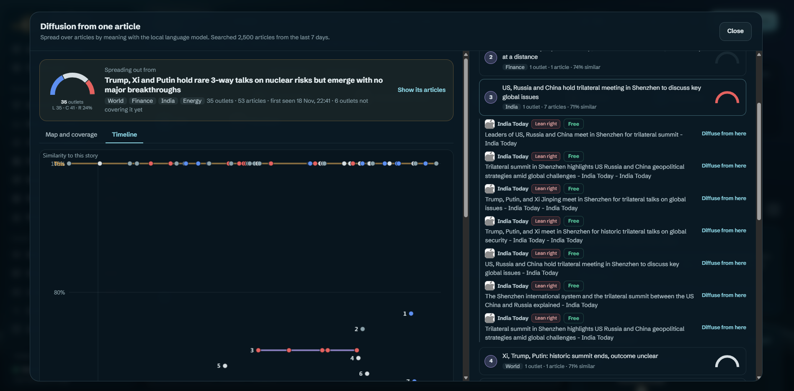

# Cutting through the noise: when one outlet floods a story

Sanjaya is meant to show you many accounts of the world, and to say where each one comes from. One way it can fail is quiet: a single outlet publishes the same story again and again, lightly reworded, and the sheer number of its articles crowds out everyone else. You then hear one voice many times and take it for many voices.

The diffusion view's **Timeline** makes this visible at a glance. This page walks through a real example and explains what to check before you act.

## What you're looking at

The view started from one article, *Trump, Xi and Putin hold rare 3-way talks on nuclear risks but emerge with no major breakthroughs*, by pressing **Diffuse** on its card. Sanjaya then spread outward by meaning over 2,500 articles from the last seven days.

On the **Timeline** tab (left):

- **Each line is one story.** The top line, marked *This*, is the starting story. The numbered lines below it are related stories, numbered as in the list on the right.
- **Height is similarity.** A line's height shows how close that story is in meaning to the starting story (100% at the top).
- **Each dot is one article,** placed at its publication time and coloured by its outlet's lean: blue for left-leaning, red for right-leaning, white for centre, grey for not rated.
- **A line runs from a story's first article to its last.** A long line means the story kept being published over hours or days.

The top line is what healthy coverage looks like: many dots, many colours, from many outlets.

## What the example shows

**Story 3** is different. Its line is a band of red dots only, stretched across the afternoon and evening. The list on the right says why: *India · 1 outlet · 7 articles · 71% similar*. Opened, it shows seven headlines from **India Today**, all about the same Shenzhen meeting:

- *Leaders of US, Russia and China meet in Shenzhen for trilateral summit*
- *Trilateral summit in Shenzhen highlights US Russia and China geopolitical strategies amid global challenges* (twice)
- *Trump, Putin, and Xi Jinping meet in Shenzhen for trilateral talks on global issues*
- *Trump, Putin, and Xi meet in Shenzhen for historic trilateral talks on global security*
- *US, Russia and China hold trilateral meeting in Shenzhen to discuss key global issues*
- *The Shenzhen international system and the trilateral summit between the US China and Russia explained*

Read side by side, these say much the same thing. One outlet, one event, seven articles, and little that the first did not already say.

## Why it matters

A system that collects news rewards volume. An outlet that publishes the same story seven times can, by repetition alone, appear more often on your desks, in search results and in the article counts. It doesn't need to be wrong to distort your picture of the day; it only needs to be loud.

This is the blindness Sanjaya is named against. Dhritarashtra's problem was not that he heard nothing, but that what he wanted to hear drowned out the rest. A wall full of one outlet's rewrites is a small version of the same thing.

## Check before you act

One band is a signal, not a verdict. Before blocking anyone, check:

1. **Is there new information?** Compare the articles in the band. New facts, figures, quotes, a later development or a genuine explainer are reporting. The same facts reworded are noise.
2. **Is it a pattern?** Diffuse two or three other big stories over a few days. An outlet that forms a one-colour band on most of them is behaving differently from one that did so once.
3. **Is it live coverage?** A running story, such as a summit, a disaster or an election count, legitimately produces many short updates. Look for times and "live" in the headlines.
4. **Is it Sanjaya counting twice?** Sanjaya collects some outlets both from their own feeds and through Google News, which adds the outlet's name to the end of each headline. In the example, *Trilateral summit in Shenzhen highlights …* appears twice, once ending *India Today – India Today*. That pair is most likely one article that reached Sanjaya by two routes, not two articles. Repeated outlet names like this point to Sanjaya's collection, not to the outlet.

## What you can do

From the gentlest step to the strongest:

- **Remove the articles from the wall.** Every card can be removed, and removals can be undone. Use this when it's a one-off.
- **Don't make the outlet primary,** or remove it from your primary sources. Primary sources lead every desk.
- **Block the outlet.** In **Sources**, find the outlet and click **Block**. Blocked publishers disappear from every page, including the emergency newsroom and the language model's input, and Sanjaya stops fetching them. **Blocked – undo** on the same card reverses it.

Blocking is the right step when the checks above show a habit: the outlet repeatedly floods stories with rewrites that add nothing. It isn't a judgement on the outlet's accuracy or politics, and the lean colour plays no part in it. An outlet of any lean can flood a story, and in the example the same check would apply if the band were blue.

## In short

1. Press **Diffuse** on a story, open **Timeline**, and look for a long band of one colour.
2. Open that story in the list. If it is one outlet, read the headlines side by side.
3. Rule out live coverage and duplicate collection.
4. If it's a habit, block the outlet in **Sources**. You can always undo it.
